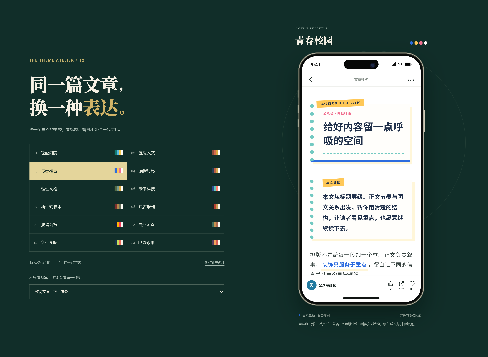
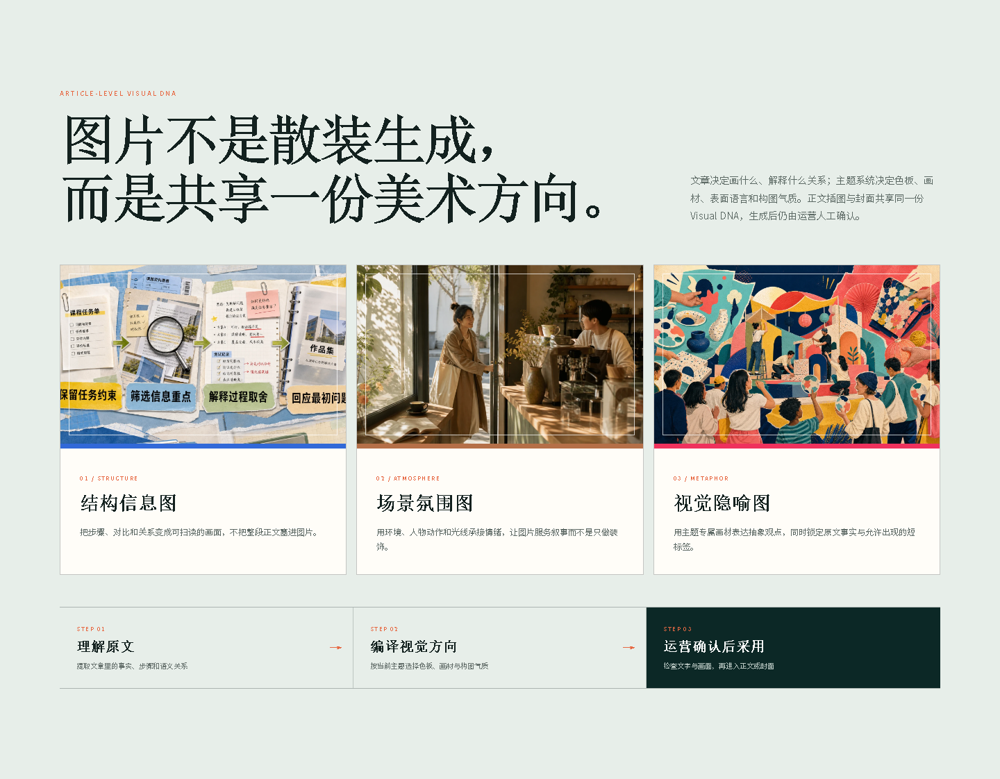

# WeChat Visual Director — 微信公众号 AI 排版 Skill

> 先让 Agent 读懂文章，再把文章排好。你在工作台定稿，交付到公众号。

[](https://github.com/zhouke0929/wechat-visual-director/releases)
[](https://github.com/zhouke0929/wechat-visual-director/actions/workflows/ci.yml)
[](LICENSE)
[](#系统要求)
[](#系统要求)

一篇内容写好了，真正发出去之前，往往还要花时间分层级、挑样式、找配图、裁封面，再来回检查手机效果。

**WeChat Visual Director（公众号视觉主编）是一套开源的微信公众号 AI 排版 Skill + 本地可视化工作台。** 把选题、资料或已有文章交给 Agent，它负责整理内容、规划版式；你在工作台直接修改原文、切换主题、审核配图与封面，最后复制、导出，或保存到微信公众号草稿箱。

适合公众号运营、新媒体团队，以及希望把 AI 初稿进一步打磨成可交付推文的创作者。

从选题起稿时，写作由你使用的 Agent 完成；本产品提供的是从结构规划、视觉排版到审核交付的工作流程。

<p align="center">
  <a href="#快速开始"><b>交给 Agent 安装</b></a>
  · <a href="https://zhouke0929.github.io/wechat-visual-director/"><b>先看完整文章与主题效果</b></a>
  · <a href="https://github.com/zhouke0929/wechat-visual-director/releases"><b>版本与更新记录</b></a>
</p>

> **给安装 Agent：** 用户要求安装本产品时，请完整执行 [INSTALL_FOR_AGENT.md](INSTALL_FOR_AGENT.md)，完成轻量 Skill、本地工作台、检查、打开页面和上手说明；不要只回复“Skill 已下载”。首次安装或明确升级使用当前安装入口，不从旧 README、截图或历史发布说明选版本。只下载文件或无法执行时，如实说明下一步。

## 先看成稿，再决定要不要试

同一套排版能力，可以用于教程、商业分析和品牌观点。下面是三篇完整的公开示例，点击即可阅读，无需安装或配置 Key。

<table>
  <tr>
    <td width="33%"><a href="https://zhouke0929.github.io/wechat-visual-director/articles/campus.html"></a></td>
    <td width="33%"><a href="https://zhouke0929.github.io/wechat-visual-director/articles/coffee.html"></a></td>
    <td width="33%"><a href="https://zhouke0929.github.io/wechat-visual-director/articles/pop-collaboration.html"></a></td>
  </tr>
  <tr>
    <td><b>把课程作业变成作品集</b><br>教程步骤 · 青春校园<br><a href="https://zhouke0929.github.io/wechat-visual-director/articles/campus.html">阅读完整推文 →</a></td>
    <td><b>社区咖啡店，如何让客人再来</b><br>本地商业 · 温暖人文<br><a href="https://zhouke0929.github.io/wechat-visual-director/articles/coffee.html">阅读完整推文 →</a></td>
    <td><b>联名越做越多，为何反而记不住</b><br>品牌观点 · 波普海报<br><a href="https://zhouke0929.github.io/wechat-visual-director/articles/pop-collaboration.html">阅读完整推文 →</a></td>
  </tr>
</table>

示例为公开演示内容，不含公司内部稿件或运营数据；配图为 AI 生成并经人工选用。在线展示是静态样例，实际编辑在安装后的本地工作台进行。

## 让内容、排版和配图一起服务阅读

### 先理解信息关系，再安排版式

“这三点是并列观点，还是必须依次执行的步骤？”“这一段是证据，还是结论？”

Agent 先回答这些问题，再选择适合的呈现方式：让对比有边界、步骤有顺序、摘录有出处、重点容易被看见。现有 **12 类语义组件、6 类文章骨架**，按内容需要组合，不把每个段落都塞进卡片。

Agent 输出结构化规划，本地程序用受控组件渲染，完成 Markdown 到微信兼容 HTML 的转换。你不必先把文章手工整理成完美的 Markdown，也不需要让模型从零拼出整页 HTML。

### 12 套主题，换的是整篇文章的阅读气质

从轻盈阅读、温暖人文，到编辑对比、新中式雅集、未来科技；每套主题都有自己的标题、色彩、留白、章节节奏和组件样式。

可以在工作台整篇切换，正文与已有图片会保留。**切换主题本身不会重新调用图片模型**；如果希望图片也适配新风格，再主动生成新候选。

[](https://zhouke0929.github.io/wechat-visual-director/#themes)

[打开在线主题样本册，比较同一篇文章的不同表达 →](https://zhouke0929.github.io/wechat-visual-director/#themes)

### 在成稿上直接改字，不用退回一个小窗口

内容校对页支持在正文位置编辑，自动保存；切到手机预览，就能检查修改后的阅读效果。主题、图片、封面与最近任务也都在同一个工作台里。

桌面校对使用 **600px 内容区**，手机预览使用 **405px 画布**，参考实际微信展示校准。它是受控的文章编辑器，不是任意拖拽页面设计器：编辑的是标题和正文等内容，装饰、组件结构与图片走各自的审核操作。

微信版本、设备宽度和字体仍可能带来差异；最终发送前，建议再用公众号后台和手机预览核对。

### 正文配图与封面，共享一份美术方向

文章决定画什么，主题决定色彩、材质和构图气质。结构信息图解释步骤与关系，场景图承接叙事，视觉隐喻图表达抽象观点；封面与正文配图共享文章级视觉方向。



如果 Agent 本身支持可调用的原生生图工具，确认主题后可以直接让它生成正文与封面候选；也可以连接图片模型 API，或上传自己的图片。候选需要你审核后采用，封面显示区可以调整。

**生图不是必选项。** 没有生图工具或图片 Key，也能完成排版、编辑、预览和导出。AI 图中的文字、事实和细节仍需人工检查。

## 从一个选题，到一篇待发布的推文

1. **在 Agent 对话里开始。** 给一个选题、一组资料，或粘贴现成的纯文本 / Markdown。Agent 整理结构、完成语义规划，再返回本地任务链接。
2. **在工作台里定稿。** 换主题、原文编辑、审核正文图片、选封面，来回检查桌面校对与手机预览。不需要在首页手动上传 Markdown。
3. **选择交付方式。** 复制全文、下载交付包，或配置微信连接后创建公众号草稿。最终群发仍由你在微信中确认。

第一次可以只体验排版，满意后再开通图片和草稿交付能力，不必一上来配置所有服务。

## 快速开始

安装器会注册 Codex、通用 Agent Skill 目录与 OpenCode。其他宿主需要支持读取 Skill 和执行本机命令；是否有原生生图工具，取决于宿主而不是本 Skill。

可以从能操作本机的 Codex 桌面端 / CLI 或 OpenCode 开始；只有网页聊天、无法操作本机文件和命令的环境，不能直接完成这套本地安装。请先完成宿主自身的模型配置、登录和额度准备。

### 把这段话发给你的 Agent

```text
请为我安装或升级完整的 wechat-visual-director，并打开本地工作台。
请先完整阅读并执行下面的安装说明，使用当前安装入口，不要沿用旧文档里的固定版本：
https://github.com/zhouke0929/wechat-visual-director/blob/main/INSTALL_FOR_AGENT.md

需要同时安装轻量 Skill 和工作台，运行 doctor --json 确认就绪；
不要只下载 Skill 文本，也不要把整个源码仓库放进 Skill 目录。
完成后返回实际安装版本、工作台链接，以及不超过五行的上手说明和下一句使用示例。
如果受限未完成，请说明停在哪一步。不要读取或回显任何密钥。
```

安装器会读取 [main/VERSION](https://raw.githubusercontent.com/zhouke0929/wechat-visual-director/main/VERSION)，下载对应的已发布 Release 包并校验 SHA-256；Windows 与 macOS 都使用不写死版本的入口。若对应包还未发布或无法下载，应报告失败，不悄悄换成历史版本。日常“打开工作台”复用已有安装，不强制升级。

普通安装无需预装 Git、Python、Node.js、pnpm 或 Homebrew。完整安装包括本地程序及运行环境，**不只是一个 `SKILL.md` 文件**。需要自己执行命令时，见[安装与维护指南](docs/usage-guide.md#手动安装与升级)。

只把仓库链接发给 Agent，说“帮我安装这个 Skill”也可以；不同宿主的安装行为不完全一致。如果它只回复“Skill 已添加”，下一句说：

> 打开公众号工作台，并简单告诉我怎么开始。

支持的首次使用流程会继续准备工作台。完整提示词能更明确地表达“装好并打开”的要求，但不能替代宿主的执行权限或保证每个 Agent 都自动接续。

### 安装后，试着发出第一条需求

```text
请用 wechat-visual-director，帮我写一篇关于“社区咖啡店如何让客人愿意再来”的公众号文章。
先整理内容和结构、完成语义规划，再打开本机工作台让我编辑和审核。
不要虚构经营数据，暂时不要生成图片或创建公众号草稿。
```

已有文章可以这样说：

> 用 wechat-visual-director 帮我排版下面这篇文章。保留原意和事实，先整理结构、完成规划，再打开工作台让我确认。［粘贴文章或附上文件］

主题确认后，若 Agent 支持原生生图，再说：

> 按当前主题，为这篇文章的正文和封面生成候选，放回工作台让我审核。

首页也保留简短流程与可复制指令；离开后可从“最近任务”继续，不必重新生成文章。

## 需要配置什么？

| 你想做到哪一步 | 需要准备什么 |
|---|---|
| 整理内容、排版、编辑、预览、复制或导出 | 一个能使用本 Skill、执行本机命令的 Agent；项目无需额外文本模型 Key |
| 让宿主 Agent 生成正文图片与封面 | 宿主有可调用的生图工具及可用额度；不必另填项目图片 Key |
| 让工作台直连图片模型 | 在“本地设置”填写图片 Endpoint、模型和 API Key |
| 保存到微信公众号草稿箱 | 账号具有相应接口权限；在本地设置配置 AppID、AppSecret 和公网 IP 白名单，并通过连接检测 |

“无需额外 Key”不代表模型使用免费；Agent 订阅、模型与图片服务费用由对应服务商计收。上传自己的图片不需要图片 API。

未配置微信连接时，可以复制排版后的富文本到公众号后台，或下载交付包后自行处理。剪贴板和微信编辑器可能限制外链图片，粘贴后仍需核对图片；直接草稿交付需要表中的微信配置。

[查看图片连接、公众号配置与排障 →](docs/usage-guide.md)

## 本地优先，也保留必要的人工确认

- **数据保存在自己的电脑。** 程序版本与任务、图片、私有配置分开存放；正常升级保留数据，普通卸载也可保留数据。
- **本地不等于离线。** 提交给 Agent 的文章受宿主服务的数据政策约束；启用图片服务或微信交付时，相应内容会发送到对应服务。
- **凭据只填本地设置。** 不把 API Key、AppSecret、Cookie 或 Token 粘贴进 Agent 对话，也不提交到仓库。
- **草稿不等于发布。** 配图、封面与最终稿由你确认；创建草稿不自动群发。事实、图片文字与素材权利仍需发布者核对。

项目已用于真实公众号交付，但仍处于 Alpha 阶段。项目与腾讯、微信官方无隶属或背书关系。

## 系统要求

- **Windows：** Windows 10/11 x64，PowerShell 5.1 或更新版本，正式支持。
- **macOS：** Apple Silicon 与 Intel 提供自包含安装包，目前为 Technical Preview；尚不等同于两种架构均完成真实设备完整人工验收。
- **宿主与网络：** Agent 能读取 Skill、执行本机命令；可访问 GitHub 下载入口，浏览器能打开本机 `127.0.0.1` 地址。Linux 暂无本文承诺的便携安装流程。

[安装版本与资产](https://github.com/zhouke0929/wechat-visual-director/releases) · [升级、排障与卸载](docs/usage-guide.md#升级卸载与数据保留) · [Agent 完整安装协议](INSTALL_FOR_AGENT.md)

## 开发与贡献

欢迎反馈实际公众号后台或手机端的兼容问题，也欢迎贡献主题、组件样式和图片风格。反馈时请附主题名、复现步骤与已脱敏截图；不要上传密钥、任务数据库或未公开稿件。新增语义组件需要同时维护规划、渲染与验证，当前还不是免代码的扩展包安装功能。

<details>
<summary>展开源码结构与开发验证</summary>

普通用户使用上面的 Release 安装流程；下面面向源码开发者。

- `skills/wechat-visual-director/`：可分发的轻量 Skill、首次使用脚本与协议参考。
- `apps/api/`：本地服务、规划校验、组件渲染、数据与草稿交付。
- `apps/web/`：工作台源码及预构建产物。
- `scripts/`：安装、启动、打包与验证脚本。
- `site/`：无需后端的公开产品页、主题样册和完整文章。
- `contracts/`、`samples/`、`docs/`：接口契约、中性样例与设计 / 发布记录。

准备好 Python 与 Node.js 开发环境并安装项目依赖后：

```powershell
python -m pip install -e "apps/api[dev]"
python -m pytest apps/api/tests -q
corepack pnpm@11.7.0 --dir apps/web install --frozen-lockfile
corepack pnpm@11.7.0 --dir apps/web typecheck
corepack pnpm@11.7.0 --dir apps/web build
python scripts/export_theme_gallery.py --check
```

测试也会检查公开安装入口，防止 README 和安装指南重新写死某个版本。历史版本的固定命令只保留在 `docs/releases/`，用于追溯该版本，不作为首次安装入口。

Windows 与 macOS 的 CI 执行核心测试和工作台构建；Release 流程构建三种平台包并进行隔离安装冒烟测试。

</details>

## License

[Apache License 2.0](LICENSE)。第三方依赖和外部服务分别受其自身许可证与条款约束。

---

**想先看看效果？** [打开在线样本册](https://zhouke0929.github.io/wechat-visual-director/#themes)。

**想用自己的文章试一遍？** [复制安装提示词](#快速开始)，把第一篇文章交给 Agent。
